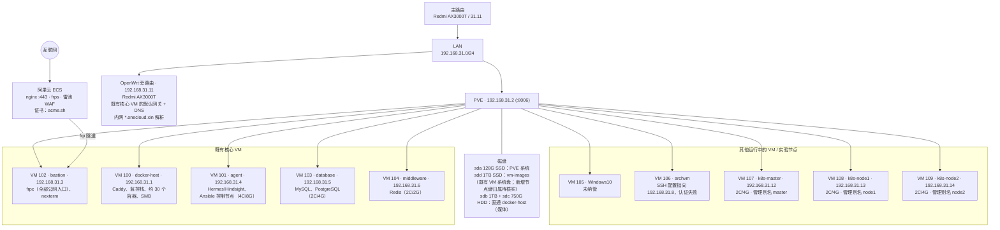

> 这页回答"Homelab 现在是什么样、靠什么连起来、哪里脆弱"。
> **机器事实**（IP、配置、磁盘、容器、监控覆盖）以自动生成的 [[01-主机清单]] 为准，**服务**（端口、数据目录、入口、依赖、重要性）以 [[03-服务清单]] 为准；这里只写需要人来判断的部分：拓扑、依赖、风险、决策。
> 最后更新：2026-11-03（用户提供最新 PVE 导出；Ansible 成功采集 5 台核心 VM 和 3 台 Kubernetes 节点。Windows10 未纳管，archvm SSH 认证失败，仅保留 PVE 信息）

## 一句话

一台 PVE（36 线程 / 64G）当前有 **10 台运行中的 VM**：5 台核心 VM、Windows10、archvm，以及 3 台按 Kubernetes 角色命名的节点；绝大多数服务集中在 **docker-host** 一台 VM 的 Docker 里。既有核心 VM 的网关和 DNS 是 OpenWrt 旁路由 **192.168.31.11**；公网访问经 **阿里云 ECS → frp → bastion** 进来，ShiftBalance 已接入 ECS 上的雷池 WAF；**仍未配置 PVE 备份任务**。

## 拓扑




旧 hybin 已删除，VMID 107 已复用于 k8s-master。本次三台 Kubernetes 节点仅采集到 SSH 与本机 DNS 监听，尚不能据此确认 Kubernetes 集群已部署；用途级别暂按实验登记。

## 访问路径

| 场景 | 路径 |
|---|---|
| 在家访问服务 | 浏览器 → OpenWrt DNS 把 `*.onecloud.xin` 解析到内网 → docker-host Caddy（:443）→ 容器 |
| 公网访问服务 | 浏览器 → ECS nginx :443（HTTPS）→ 已接入的站点经雷池 → frps → bastion frpc → 内网服务 |
| SSH 管理 | Mac → 各 VM；docker-host → agent（Claude 专用密钥）→ agent 上的 Ansible → 其他 VM |
| 告警 | Prometheus / Loki ruler → Alertmanager → ntfy（docker-host）→ 经公网入口 → 手机 |
| 告警诊断 | 指定的主机失联、容器重启循环/OOM 告警 → Alertmanager → agent Hermes Webhook → 只读查询 Prometheus/Loki → 微信；模拟消息已确认在渠道恢复后补投递成功，见 [[Hermes 告警诊断 Webhook 接入 SOP]] |

经 frp 暴露的服务和 Caddy 站点见 [[01-主机清单#公网暴露]]。**公网只应该走 ECS nginx 的 443**；frp 远端端口不要在安全组放行（2026-10-07 发现 nexterm 6989、OpenList 5244 曾以明文 HTTP 直接对公网开放，已关闭）。

ShiftBalance 的链路为 nginx → 雷池 `127.0.0.1:18080` → frps `8082` → bastion → docker-host `8082`；雷池接入依据见 [[雷池 WAF 公网服务接入 SOP]]。其他站点是否全部接入雷池尚未核实。

## 关键依赖与单点

| 单点 | 挂了会怎样 |
|---|---|
| **PVE 宿主机** | 一切停摆 |
| **sdd（vm-images SSD）** | 2026-10-07 核实的既有 VM 系统盘集中于此；坏了且没有备份，核心配置和数据会丢失。新增 Kubernetes 节点的磁盘归属不能从本次资源导出判断 |
| **OpenWrt 旁路由 31.11** | 依赖它的 VM 同时失去网关和 DNS，影响外网访问和内网域名解析 |
| **docker-host** | 绝大多数服务 + 监控告警本身一起挂，**告警也发不出来** |
| **docker-host 的 sdb**（`/mnt/jellyfin`） | 有一片已知坏块（8 月发现，2026-10-08 处理完，受损文件已删除）；媒体没有第二份。见 [[磁盘坏道排查与修复记录]] |
| **bastion** | 所有公网访问中断（含手机收告警） |
| **ECS** | 同上；证书、nginx、frps 和雷池都在这一台 |
| **agent** | 不影响服务运行，但失去 Ansible 管理入口；**Hindsight 记忆服务也在这台上**——它满载时 Hermes 读不到长期记忆（2026-11-01 已因默认重排参数烧满 2 核，见 [[2026-11-01-hindsight-rerank-timeout]]） |

## 监控覆盖

核心 VM 的指标和日志此前均已确认接入；2026-11-03 查询确认 5 台核心 VM 的指标正常，database 在最近 15 分钟窗口未查到日志，其余 4 台有日志。这不等于 database 未接入。2026-10-15 用户确认 PVE、OpenWrt、ECS 也已纳入监控；本次未重新核对这三者。快照结果及查询口径见 [[01-主机清单#虚拟机]] 的"监控"列。

已知缺口：

- archvm 和 Windows10 当前运行中，仍未纳入本次监控覆盖核验。
- 3 台 Kubernetes 节点暂按实验登记，监控覆盖与重要性待确认。

相关：[[Prometheus 告警 → ntfy 手机推送]]、[[Loki 日志告警与监控组件自监控]]、[[容器监控与告警（cAdvisor + Docker 重启次数）]]、[[Ansible 批量部署 Alloy 实战记录]]

## 备份现状

**PVE 无备份任务。** 2026-11-03 用户提供的 `pvesh get /cluster/backup` 结果仍为空。各服务无单独备份是既有记录，本次未重新审计服务级备份。

2026-10-07 决定：**暂不做备份**。各种故障场景下能恢复到什么程度、哪些数据不可替代，见 [[04-备份与恢复]]。vm-images 存储所在磁盘损坏会使其上的 VM 系统盘及数据（含 Vaultwarden 密码库、数据库）丢失；PVE 系统盘单独损坏时，其他盘上的 VM 磁盘仍可能恢复，具体按故障域判断。

## 已知问题

> 已经发生过的问题和处理经过见 [[00-事件索引|事件记录]]。

- [x] docker-host sdb 坏道：已确认并处理，受损文件已删除，之后观察 SMART 计数，见 [[2026-10-07-sdb-bad-sector]] ✅ 2026-10-08
- [x] Hindsight reflect 超时烧满 agent 2 核：默认重排候选数（300）与 2 核规格不匹配，导致 mental model 一个月零刷新。已降候选数 + 抬墙钟 + agent 升 4C/8G + 刷新加 24h 间隔，见 [[2026-11-01-hindsight-rerank-timeout]] ✅ 2026-11-01
- [ ] 主路由信息、Windows10 用途待补充；archvm（VM 106）正在运行，但 2026-11-03 SSH 认证失败，尚无主机内采集数据
- [ ] Kubernetes 三台节点的实际部署进度、重要性及系统盘所在存储待确认
- [ ] docker-host 系统盘使用率已到 83%（75G/96G，2026-11-03 采集），需关注容量增长
- [x] pveui 残留的 `pve-mysql` 容器和空卷已删除（前后端保留，连 database 的 MySQL） ✅ 2026-10-07
- [x] Syncthing 已删除 ✅ 2026-10-07
- [ ] [[03-服务清单]] 里 ✏️ 标记的重要性待确认；Redis 暂保留

## 怎么更新

机器事实不要手改，重新生成 [[01-主机清单]]：

```bash
ssh agent
cd /root/homelab-inventory
export PATH=$HOME/.local/bin:$PATH
ansible-playbook -i hosts.ini collect.yml    # 只读采集各 VM
python3 render.py                            # 生成 out/01-主机清单.md
python3 render_services.py                   # 生成 out/03-服务清单.md
```

然后把 `out/` 下的两个文件复制到知识库 `homelab/`。服务的重要性、文档链接、备注在 `services-meta.yml` 里改（人工判断层），改完重新生成；新装的服务没登记会出现在服务清单的"未登记"一节。

PVE 层数据目前靠手工导出（没有给 API 权限），VM 增减时在 PVE 上重新导出：

```bash
pvesh get /cluster/resources --output-format json > /tmp/pve-resources.json
pvesh get /cluster/backup    --output-format json > /tmp/pve-backup.json
```

放到 agent 的 `/root/homelab-inventory/pve/resources.json`、`backup.json`。新增 VM 时同时在 `hosts.ini` 里加一行（VMID / 用途 / 级别）。

先更新 PVE 导出和 `hosts.ini`，再采集、渲染，避免新采集混入旧 PVE 规格。主机退役或 VMID 复用时同步修订 inventory；生成器只读取当前 inventory 对应的 facts，旧 hybin 快照不会再混入。部分主机 SSH 失败时仍可生成，但要明确保留采集缺口；不要把未取得的数据当作当前事实。

> 旧的服务规划清单见 [[Homelab 服务愿望清单]]，那是愿望清单，不代表当前状态。
