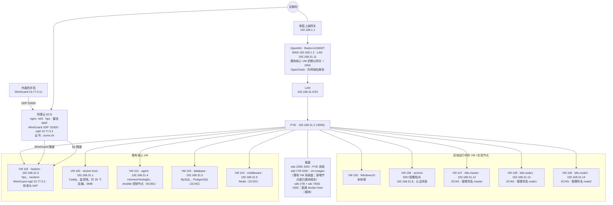

> 这页回答"Homelab 现在是什么样、靠什么连起来、哪里脆弱"。
> **机器事实**（IP、配置、磁盘、容器、监控覆盖）以自动生成的 [[01-主机清单]] 为准，**服务**（端口、数据目录、入口、依赖、重要性）以 [[03-服务清单]] 为准；这里只写需要人来判断的部分：拓扑、依赖、风险、决策。
> 最后更新：2026-11-13，依据已确认的部署与验收结果补齐 WireGuard、OpenWrt 网络路径及 Orca 规划。本次未运行采集脚本；[[01-主机清单]]、[[03-服务清单]] 的机器、容量、运行与监控数据仍为 2026-11-03 快照，不代表本次实时检查。

## 一句话

一台 PVE（36 线程 / 64G），最近一次资源快照记录 **10 台运行中的 VM**：5 台核心 VM、Windows10、archvm，以及 3 台按 Kubernetes 角色命名的节点；绝大多数服务集中在 **docker-host**。既有核心 VM 使用 OpenWrt **192.168.31.11** 作为网关和 DNS。Web 公网入口走 **ECS → frp → bastion**；异地访问另有 **手机 WireGuard → ECS → bastion → 家庭内网 / OpenWrt OpenClash**，手机内网访问及 Google 代理上网均已验收。**Orca 尚未安装**；最近一次 PVE 导出没有备份任务。

## 拓扑




旧 hybin 已删除，VMID 107 已复用于 k8s-master。最近一次采集在三台 Kubernetes 节点上仅发现 SSH 与本机 DNS 监听，不能据此确认 Kubernetes 集群已部署；用途级别暂按实验登记。

OpenWrt 为独立设备，系统为 OpenWrt 25.12.5。其 WAN 默认路由经上级网关 `192.168.1.1`，LAN 为 `192.168.31.0/24`。WireGuard 家庭端放在 bastion，OpenWrt 承担家庭网关、DNS 和 OpenClash 职责。

## 已确认的部署状态

| 项目 | 状态 | 说明 |
|---|---|---|
| WireGuard 异地组网 | 已部署、手机验收通过 | ECS 公网接入，bastion 转发与 NAT；手机内网访问、代理上网及 Google 可用；两端已配置开机启动 |
| Orca 服务端 | 未安装、待部署 | 计划部署于 agent `192.168.31.4`，经现有 WireGuard 接入，使用 agent 上的 SSH 访问其他 VM |
| 自动主机 / 服务清单 | 保留原采集快照 | 仍为 2026-11-03；后续重新采集时需将 WireGuard 的 UDP 监听及 systemd 单元纳入生成器 |

对应文档：[[WireGuard 异地访问部署方案]]、[[Orca 服务端本地部署方案]]。部署方案存在不代表服务已安装。

## 访问路径

| 场景 | 路径 |
|---|---|
| 在家访问服务 | 浏览器 → OpenWrt DNS 把 `*.onecloud.xin` 解析到内网 → docker-host Caddy（:443）→ 容器 |
| 公网访问服务 | 浏览器 → ECS nginx :443（HTTPS）→ 已接入的站点经雷池 → frps → bastion frpc → 内网服务 |
| 手机异地访问内网 | 手机移动数据 → WireGuard → ECS UDP 51820 → bastion wg0 → 家庭 VM；bastion 在 ens18 做 NAT，目标看到来源为 192.168.31.3 |
| 手机使用家庭代理 | 手机只开 WireGuard → ECS → bastion → OpenWrt/OpenClash → 按规则直连或代理；已确认 Google 可访问 |
| 家庭 VM 出网 | VM → OpenWrt 192.168.31.11 → WAN 192.168.1.2 → 上级网关 192.168.1.1 → 互联网 |
| SSH 管理 | Mac → 各 VM；docker-host → agent（Claude 专用密钥）→ agent 上的 Ansible → 其他 VM |
| 告警 | Prometheus / Loki ruler → Alertmanager → ntfy（docker-host）→ 经公网入口 → 手机 |
| 告警诊断 | 指定的主机失联、容器重启循环/OOM 告警 → Alertmanager → agent Hermes Webhook → 只读查询 Prometheus/Loki → 微信；模拟消息已确认在渠道恢复后补投递成功，见 [[Hermes 告警诊断 Webhook 接入 SOP]] |

经 frp 暴露的服务和 Caddy 站点见 [[01-主机清单#公网暴露]]。**已发布 Web 服务的公网入口应走 ECS nginx 443**；frp 后端端口不要在安全组直接放行。WireGuard 使用独立的 **UDP 51820**，不经过 nginx、雷池或 frp。

WireGuard 的 ECS 端仅对指定客户端来源使用策略路由表 177，ECS 自身保留原默认出口；bastion 保留经 OpenWrt 的默认路由。当前提供 IPv4 访问，隧道内 IPv6 在 ECS 拒绝，手机 IPv6 行为尚未专项验收。手机上网会消耗 ECS 公网流量或带宽；ECS 是解密、再加密的可信节点，密钥值不记录在知识库。

ShiftBalance 的链路为 nginx → 雷池 `127.0.0.1:18080` → frps `8082` → bastion → docker-host `8082`；雷池接入依据见 [[雷池 WAF 公网服务接入 SOP]]。其他站点是否全部接入雷池尚未核实。

## 关键依赖与单点

| 单点 | 挂了会怎样 |
|---|---|
| **PVE 宿主机** | 一切停摆 |
| **sdd（vm-images SSD）** | 2026-10-07 核实的既有 VM 系统盘集中于此；坏了且没有备份，核心配置和数据会丢失。新增 Kubernetes 节点的磁盘归属不能从本次资源导出判断 |
| **OpenWrt 31.11** | 依赖它的 VM 失去网关、DNS 和代理出口；手机经 WireGuard 回家的上网路径也受影响 |
| **docker-host** | 绝大多数服务 + 监控告警本身一起挂，**告警也发不出来** |
| **docker-host 的 sdb**（`/mnt/jellyfin`） | 有一片已知坏块（8 月发现，2026-10-08 处理完，受损文件已删除）；媒体没有第二份。见 [[磁盘坏道排查与修复记录]] |
| **bastion** | 已发布服务的 frp 入口、经该入口的告警访问及 WireGuard 家庭转发中断 |
| **ECS** | Web 公网入口与 WireGuard 异地接入均中断；证书、nginx、frps、雷池和 WireGuard 都在这一台 |
| **agent** | 不影响服务运行，但失去 Ansible 管理入口；**Hindsight 记忆服务也在这台上**——它满载时 Hermes 读不到长期记忆（2026-11-01 已因默认重排参数烧满 2 核，见 [[2026-11-01-hindsight-rerank-timeout]]） |

## 监控覆盖

核心 VM 的指标和日志此前均已确认接入；2026-11-03 查询确认 5 台核心 VM 的指标正常，database 在最近 15 分钟窗口未查到日志，其余 4 台有日志。这不等于 database 未接入。2026-10-15 用户确认 PVE、OpenWrt、ECS 也已纳入监控；本次未重新核对这三者。快照结果及查询口径见 [[01-主机清单#虚拟机]] 的"监控"列。

已知缺口：

- archvm 和 Windows10 当前运行中，仍未纳入本次监控覆盖核验。
- 3 台 Kubernetes 节点暂按实验登记，监控覆盖与重要性待确认。

相关：[[Prometheus 告警 → ntfy 手机推送]]、[[Loki 日志告警与监控组件自监控]]、[[容器监控与告警（cAdvisor + Docker 重启次数）]]、[[Ansible 批量部署 Alloy 实战记录]]

## 备份现状

**最近一次 PVE 导出没有备份任务。** 依据是 2026-11-03 用户提供的 `pvesh get /cluster/backup` 空列表，本次没有重新查询。各服务无单独备份沿用既有记录。WireGuard 已有重建 SOP，但私钥、真实配置和客户端授权不保存在知识库，不能把 SOP 当作密钥备份。

2026-10-07 决定：**暂不做备份**。各种故障场景下能恢复到什么程度、哪些数据不可替代，见 [[04-备份与恢复]]。vm-images 存储所在磁盘损坏会使其上的 VM 系统盘及数据（含 Vaultwarden 密码库、数据库）丢失；PVE 系统盘单独损坏时，其他盘上的 VM 磁盘仍可能恢复，具体按故障域判断。

## 已知问题

> 已经发生过的问题和处理经过见 [[00-事件索引|事件记录]]。

- [x] docker-host sdb 坏道：已确认并处理，受损文件已删除，之后观察 SMART 计数，见 [[2026-10-07-sdb-bad-sector]] ✅ 2026-10-08
- [x] Hindsight reflect 超时烧满 agent 2 核：默认重排候选数（300）与 2 核规格不匹配，导致 mental model 一个月零刷新。已降候选数 + 抬墙钟 + agent 升 4C/8G + 刷新加 24h 间隔，见 [[2026-11-01-hindsight-rerank-timeout]] ✅ 2026-11-01
- [ ] 上级网关 192.168.1.1 的设备型号、Windows10 用途待补充；archvm（VM 106）最近一次 PVE 快照为运行，但 2026-11-03 SSH 认证失败，尚无主机内采集数据
- [ ] Kubernetes 三台节点的实际部署进度、重要性及系统盘所在存储待确认
- [ ] docker-host 系统盘使用率已到 83%（75G/96G，2026-11-03 采集），需关注容量增长
- [x] pveui 残留的 `pve-mysql` 容器和空卷已删除（前后端保留，连 database 的 MySQL） ✅ 2026-10-07
- [x] Syncthing 已删除 ✅ 2026-10-07
- [ ] [[03-服务清单]] 里 ✏️ 标记的重要性待确认；Redis 暂保留
- [ ] Orca 服务端仍待部署，不能按已运行服务登记
- [ ] 自动清单尚未重新采集；下次刷新需覆盖 WireGuard UDP 监听、接口和服务状态，采集结果不包含任何密钥值

## 怎么更新

机器事实不要手改，重新生成 [[01-主机清单]]：

```bash
ssh agent
cd /root/homelab-inventory
export PATH=$HOME/.local/bin:$PATH
ansible-playbook -i hosts.ini collect.yml    # 只读采集各 VM
python3 render.py                            # 生成 out/01-主机清单.md
python3 render_services.py                   # 生成 out/03-服务清单.md
```

然后把 `out/` 下的两个文件复制到知识库 `homelab/`。服务的重要性、文档链接、备注在 `services-meta.yml` 里改（人工判断层），改完重新生成；新装的服务没登记会出现在服务清单的"未登记"一节。

PVE 层数据目前靠手工导出（没有给 API 权限），VM 增减时在 PVE 上重新导出：

```bash
pvesh get /cluster/resources --output-format json > /tmp/pve-resources.json
pvesh get /cluster/backup    --output-format json > /tmp/pve-backup.json
```

放到 agent 的 `/root/homelab-inventory/pve/resources.json`、`backup.json`。新增 VM 时同时在 `hosts.ini` 里加一行（VMID / 用途 / 级别）。

先更新 PVE 导出和 `hosts.ini`，再采集、渲染，避免新采集混入旧 PVE 规格。主机退役或 VMID 复用时同步修订 inventory；生成器只读取当前 inventory 对应的 facts，旧 hybin 快照不会再混入。部分主机 SSH 失败时仍可生成，但要明确保留采集缺口；不要把未取得的数据当作当前事实。

> 旧的服务规划清单见 [[Homelab 服务愿望清单]]，那是愿望清单，不代表当前状态。
